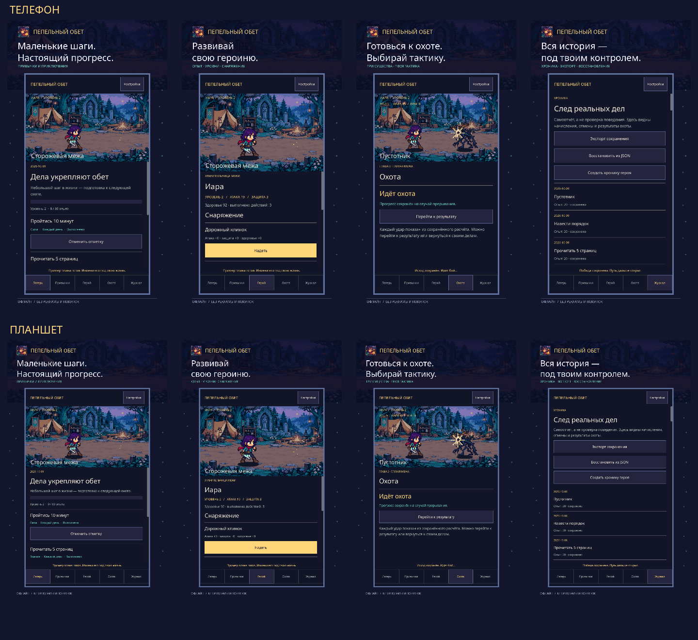

# Пепельный обет — Android RPG привычек


[Скачать Android APK](https://github.com/EdryStarz/ashen-oath/releases/latest) · Разработчик: Embertrail Studio · Поддержка: edrystars@gmail.com

Рабочий исходный вертикальный срез на **Godot4.7.2**: создать привычку → отметить реальное действие → получить награду один раз → увидеть новое снаряжение → выбрать тактику → пройти бой → восстановить прогресс после перезапуска.

Офлайн-приложение с русским интерфейсом. Версия **0.7.2** переводит активную игровую сцену в пиксельный 2D beat ’em up: лесной лагерь, Иара с четырьмя позами, три существа и вспышки ударов. Оригинальные фон и спрайты созданы с помощью imagegen; вдохновение — визуальный язык Scott Pilgrim vs. The World: The Game. Ресурсы этой игры не копируются. Все старые 3D-модели и материалы исключены из APK, старые ресурсы сохранены локально как архив разработки.

## Быстрый запуск в этой папке

```powershell
powershell -ExecutionPolicy Bypass -File tools/run.ps1
```

Или откройте `project.godot` в Godot 4.7.2 и нажмите F5 (основная сцена `main.tscn`). Никаких Node.js, веб-сервера, Unity или Compose проекту не требуется.

Для новой машины:

```powershell
powershell -ExecutionPolicy Bypass -File tools/setup.ps1 -Download
powershell -ExecutionPolicy Bypass -File tools/run.ps1
```

Python3, JDK17 и Android SDK нужны только для подготовки/Android-сборки. Скрипты держат движок и инструменты отдельно в `.tools`. Подробности и пути: [локальная сборка](docs/TOOLCHAIN.md).

## Сборка Android

```powershell
powershell -ExecutionPolicy Bypass -File tools/build.ps1
powershell -ExecutionPolicy Bypass -File tools/install_android.ps1 -Serial emulator-5554
```

Выход: `artifacts/ashen-oath-debug.apk`, package`org.ashenoath.app`, arm64-v8a и x86_64. Это отладочный пакет для локальной проверки. Фактический статус сборки и Android-проверок: [отчёт](docs/VERIFICATION.md). Наличие export preset само по себе не означает, что APK уже собран.

Для Windows: `powershell -ExecutionPolicy Bypass -File tools/build.ps1 -Platform 'Windows Desktop'`.

## Что уже работает

- Пять разделов: лагерь/сегодня, привычки, герой, охота, журнал.
- Создание/редактирование, ежедневное расписание, выбранные дни, Nраз в неделю, минимум на трудный день, пауза и планируемый отдых.
- Награды только за отметки, лимит75XP в день; повторный тап не дублирует начисление. Отмена до использования в охоте возвращает точную награду.
- Уровни, открытие и смена четырёх комплектов; визуальная смена оружия, мантии и фонаря.
- Три пассивных приёма на уровнях 3, 5 и 8, которые действительно меняют урон или здоровье.
- Три связанных контракта: два врага и босс. Короткий автобой зависит от характеристик, комплекта, подготовки и выбранной тактики. Можно сразу перейти к результату.
- Результат фиксируется до анимации, победная награда выдаётся однажды. Повтор использует сохранённый журнал и снимок героя.
- Локальные JSON-сохранения с резервной копией, валидация импорта, экспорт через файл/буфер, настраиваемая граница дня и системный часовой пояс.
- Экономичный режим, уменьшение анимаций, текст100/120/140%; камера без тряски.
- Карточка хроники PNG с настоящим текущим 3D-героем; личные названия привычек не передаются в её генератор.
- Собственные звуки лагеря, замаха, удара, резонанса, награды и победы; громкость и полное отключение в настройках. В фоне звук приостанавливается.
- Числа фактического урона и эффект «Резонанса» в бою; уменьшение анимаций отключает эти эффекты.

В первой сессии можно создать собственное дело или выбрать редактируемый пример из трёх привычек. Примеры не отмечаются автоматически. Реальные пользовательские данные и QA-профили разделены.

## Проверки

```powershell
& '.\.tools\godot\Godot_v4.7.2-stable_win64_console.exe' --headless --path . --script tests/core_tests.gd
& '.\.tools\godot\Godot_v4.7.2-stable_win64_console.exe' --headless --path . --script tests/ui_tests.gd -- --ui-tests
& '.\.tools\godot\Godot_v4.7.2-stable_win64_console.exe' --headless --path . --script tools/verify_world.gd
& '.\.tools\godot\Godot_v4.7.2-stable_win64_console.exe' --headless --path . --script tests/audio_tests.gd
python tools/check_contrast.py
python tools/financial_model.py
```

Для 0.4.1 повторены 27 проверок UI и 27 проверок 3D-представления — все прошли. Последний прогон 111 проверок ядра относится к 0.4.0. Последний прогон 12 проверок звука относится к 0.3.0. Финансовая модель — 25 проверок расчётов. Рендер-проверка `-- --qa` использует отдельное сохранение и создаёт настоящие скриншоты в `artifacts`; без этого флага приложение работает в обычном режиме.

Через [Universal Modder](https://github.com/rehan-remade/universal-modder) выполнены поиск знаний, запуск приложения и захват настоящего игрового окна. Журнал инструментария: [MODLOG.md](MODLOG.md). Скилл[UI UX Pro Max](https://github.com/nextlevelbuilder/ui-ux-pro-max-skill) прочитан, установленный поиск действительно запускался: [дизайн-система](docs/DESIGN_SYSTEM.md).

## Продукт, правила и экономика

- [Концепция, права, архитектура и целевые бюджеты](docs/PRODUCT.md).
- [Фактические формулы, сохранение, календарь, отмена и баланс](docs/GAME_RULES.md).
- [Арт-дирекция и происхождение3D](docs/ART_DIRECTION.md).
- [Конкуренты, тест спроса, монетизация и три сценария24месяцев](docs/MARKET_AND_BUSINESS.md).
- [Все предположения и помесячные расчёты](docs/financial_model.json), воспроизводимые через `tools/financial_model.py`.

Цель$1000000 совокупной валовой выручки за24месяца — явное допущение, не прогноз успеха. В базовом сценарии модель даёт около$318356 валовых поступлений и отрицательный остаток после моделируемых затрат; даже оптимистичный сценарий не равен миллиону прибыли.

## Существенные ограничения

Нужны финальная реалистичная модель героя, профессиональная доработка рига и анимаций, текстуры лица и художественная обработка звука. Звук пока синтезированный; музыкальной партитуры и озвучки нет. Сюжет ограничен тремя контрактами; развёрнутого дерева способностей, траты осколков, платных глав, покупок, напоминаний и облачной синхронизации нет. Видеохроника за месяц не реализована. Название не проверено как товарный знак.

Тесты ПК и эмулятора не доказывают30FPS, энергопотребление или стабильность на физическом Android-телефоне. Профилирование Pixel6a, TalkBack, системное масштабирование текста, вырезы экрана и release AAB остаются обязательными проверками перед магазином. APK и исходники не публиковались в Google Play; платные сервисы не подключались.

Никаких ресурсов из чужих игр. [Лицензии внешних компонентов](THIRD_PARTY_NOTICES.md). Папка `.tools` не входит в исходный распространяемый проект.


## Android environment 0.5.0
A Verdant Trail integrated: default low 169,881 triangles; optional high 481,163; selected source 4,782,317. Textures max 1024px, ETC2 Android GPU compression with mipmaps, foliage alpha cutout, shorter shadow and visibility distances. Procedural scatter and render-only source effects omitted. Original 1.9GB archive excluded. Physical-phone FPS and thermals not measured.


## 0.5.1 — forest composition
Open clearing instead of camera inside cliff scans. Textured undulating floor with a dirt trail; grass batched into a MultiMesh. Five nearby 3D pines and 48 distant native-rendered transparent pine cards. Near rocks retain detailed meshes with smoothed normals. Balanced daylight/fire and revised camera framing. Canvas tent gains folds, seams, back wall, ropes and stakes. This is a visual composition revision, not an AAA photorealism or physical-phone FPS claim.


## RuStore release 0.7.2
Подписанная release-сборка: `artifacts/rustore/ashen-oath-0.7.2-release.apk`. Витрина, политика и порядок загрузки: `docs/rustore/UPLOAD.md`. Бренд: Embertrail Studio; поддержка edrystars@gmail.com. Новый ключ хранится вне проекта; магазинный архив и исходники не содержат ключа или пароля. Политика доступна внутри приложения. Перед публикацией требуется публичная HTTPS-ссылка на её HTML-версию.


## Изображения



## Что не входит в репозиторий

Ключ подписи, пароли, установленные инструменты и частная Maiden Assassin не публикуются. Активная пиксельная сцена работает без частной модели. Старые 3D-ресурсы остаются локальным архивом и не загружаются в GitHub. Для текущей пиксельной версии они не нужны. Архивные инструменты для 3D требуют соответствующих ресурсов; актуальные проверки: tests/core_tests.gd, tests/ui_tests.gd, tests/pixel_world_tests.gd и tests/audio_tests.gd. Лицензии прежних ресурсов перечислены в THIRD_PARTY_NOTICES.md. APK и материалы для RuStore доступны отдельно в GitHub Releases.
