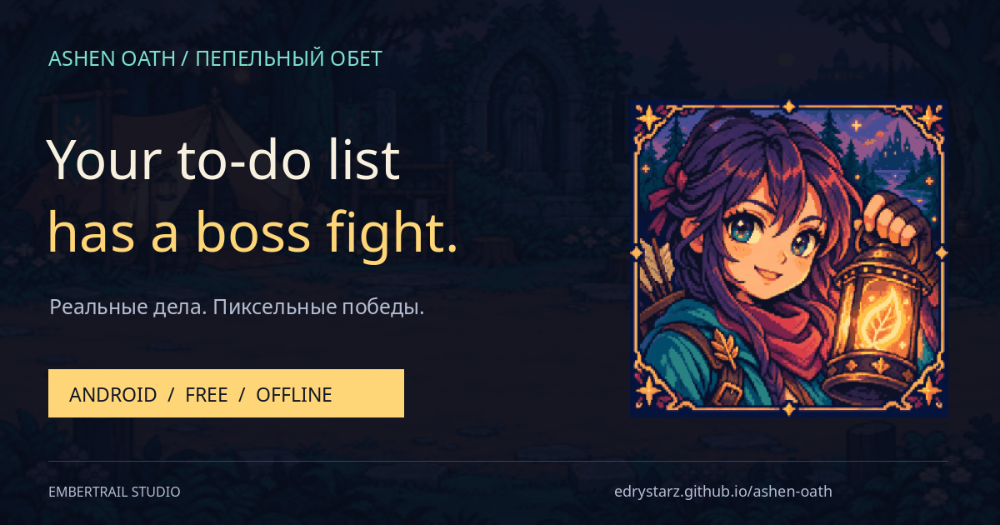
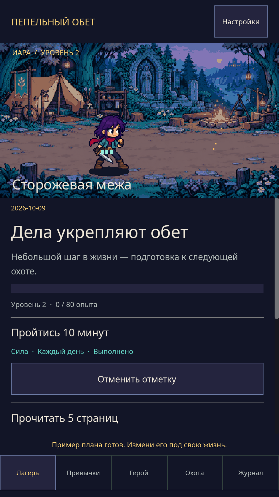
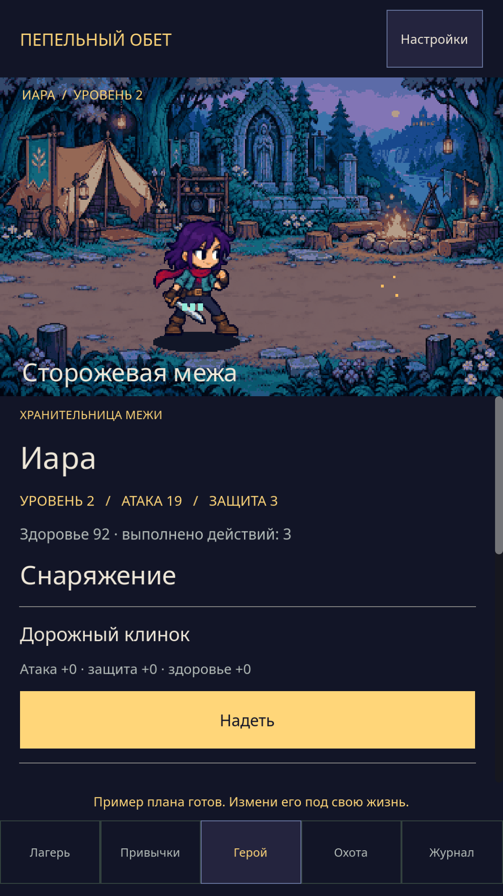
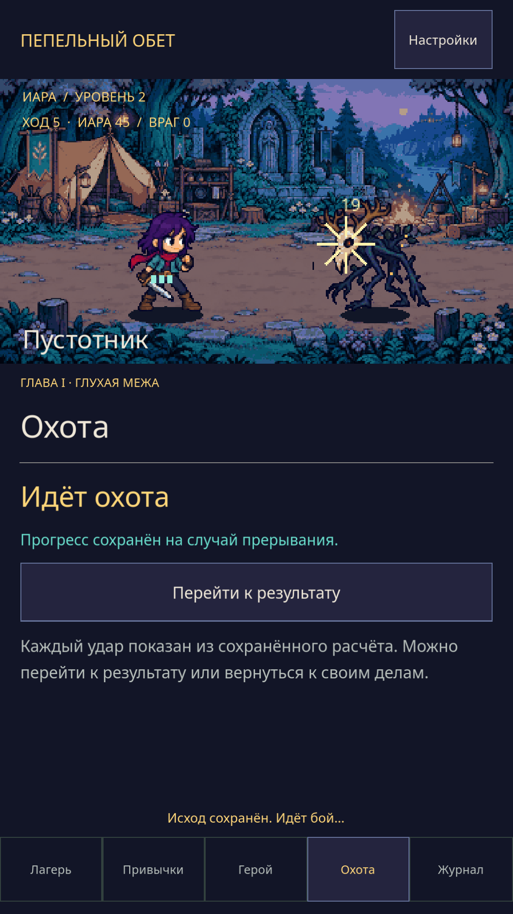

<p align="center"><a href="https://edrystarz.github.io/ashen-oath/"></a></p>

<h1 align="center">Ashen Oath · Пепельный обет</h1>
<p align="center"><b>Real-world habits. Pixel-world victories.</b><br>Реальные дела. Пиксельные победы.</p>
<p align="center"><a href="https://github.com/EdryStarz/ashen-oath/releases/download/v0.7.2/ashen-oath-0.7.2-release.apk"><b>↓ Download Android APK / Скачать игру</b></a><br><a href="https://edrystarz.github.io/ashen-oath/">English website</a> · <a href="https://edrystarz.github.io/ashen-oath/ru/">Сайт на русском</a> · <a href="#english">English</a> · <a href="#русский">Русский</a></p>
<p align="center">Free · Offline · No ads · No account · No purchases<br>Android 7.0+ · ARM64 / x86_64 · Godot 4.7.2<br><b>Game interface: Russian. Website: English + Russian.</b></p>

## English

### Your to-do list has a boss fight.

Take a walk. Read a few pages. Come back stronger. **Ashen Oath** turns your everyday actions into preparation for Iara’s next adventure.

Build a habit, choose a schedule, and mark your own progress. Earn XP, develop strength, knowledge and craft, equip your hero, and pick a tactic before facing the forest. Rest days belong in your plan, too.

**A small first chapter, not an endless promise.** Three creatures, hero progression, equipment, a habit planner, a journal, and JSON save export/import. No cloud sync, multiplayer or reminders yet. Completion is self-reported; the app does not monitor your behavior.

<p align="center"></p>

1. [Download the signed APK](https://github.com/EdryStarz/ashen-oath/releases/tag/v0.7.2) and install it on a compatible 64-bit Android device.
2. Create one small habit, or pick the three-habit starter plan.
3. Complete a real action, mark it done, and take your preparation into a hunt.

**Upgrading from an old debug build?** Export your JSON in the Journal before uninstalling. Debug and release APKs have different signatures. Install the release, then import your backup. Deleting the app without exporting removes local progress.

If the idea belongs in your daily routine, star the project or share the [website](https://edrystarz.github.io/ashen-oath/) with a friend. Feedback: **edrystars@gmail.com**.

---

## Русский

### У списка дел теперь есть босс.

Прогуляйся. Прочитай пару страниц. Вернись сильнее. **«Пепельный обет»** превращает обычные дела в подготовку к следующему приключению Иары.

Создай привычку, выбери расписание и отмечай свой прогресс. Получай опыт, развивай силу, знание и ремесло, меняй снаряжение и выбирай тактику перед встречей с существами леса. Дням отдыха тоже есть место.

**Это небольшая первая глава.** Три существа, развитие героя, снаряжение, планировщик привычек, журнал и экспорт/импорт сохранения через JSON. Облачной синхронизации, мультиплеера и напоминаний пока нет. Отметки основаны на самоотчёте: приложение не следит за поведением и не проверяет выполнение привычек.

1. [Скачай подписанную APK](https://github.com/EdryStarz/ashen-oath/releases/tag/v0.7.2) и установи на совместимое 64-битное Android-устройство.
2. Создай одно небольшое дело или выбери готовый пример из трёх привычек.
3. Выполни действие в жизни, отметь его и отправляйся на охоту с подготовкой.

**Переходишь со старой debug-сборки?** Сначала экспортируй JSON через «Журнал». Подписи тестовой и релизной APK различаются. После экспорта удали тестовую версию, установи release и восстанови JSON. Удаление приложения без экспорта приведёт к потере локального прогресса.

Нравится идея? Поддержи проект звездой и отправь другу [страницу игры](https://edrystarz.github.io/ashen-oath/ru/). Обратная связь: **edrystars@gmail.com**.

---

## Build & contribute / Разработка

Open `project.godot` in **Godot 4.7.2** and press F5. Or on Windows:

```powershell
powershell -ExecutionPolicy Bypass -File tools/setup.ps1 -Download
powershell -ExecutionPolicy Bypass -File tools/run.ps1
```

Открой `project.godot` в **Godot 4.7.2** и нажми F5. Для Android-сборки нужны Python 3, JDK 17 и Android SDK: [toolchain](docs/TOOLCHAIN.md).

- [Game rules / Правила игры](docs/GAME_RULES.md)
- [Release verification / Проверки релиза](docs/rustore/verification.md)
- [Third-party notices / Лицензии](THIRD_PARTY_NOTICES.md)
- [Privacy / Конфиденциальность](https://edrystarz.github.io/ashen-oath/rustore/privacy-policy.html)
- [RuStore publishing kit / Комплект RuStore](https://github.com/EdryStarz/ashen-oath/releases/tag/v0.7.2)

The active release is a pixel-art 2D game. Signing keys, passwords, private models and archived 3D resources are excluded from GitHub. Original art was generated with imagegen and prepared for the game; no Scott Pilgrim assets or characters are included. Physical-device performance has not been profiled.

Current tests: `tests/core_tests.gd`, `tests/ui_tests.gd` (with `-- --ui-tests`), `tests/pixel_world_tests.gd`, `tests/audio_tests.gd`. Legacy 3D tools require archived assets and are not part of the active release. The website is static: English `docs/index.html`, Russian generated by `python tools/build_landing.py`. No third-party analytics.

**Embertrail Studio · edrystars@gmail.com**
